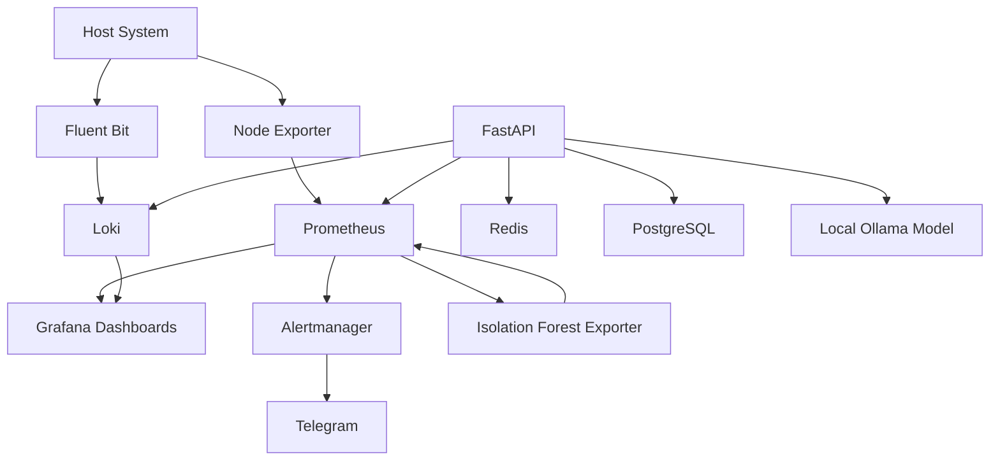

# AegisMonitor AI

**A local, self-hosted infrastructure monitoring and AI-assisted anomaly analysis platform.**

AegisMonitor AI combines infrastructure metrics, log monitoring, deterministic alerting, machine-learning anomaly detection, multi-signal correlation, persistent incident-related data, and locally hosted AI analysis in one Docker Compose-based environment.

The project is designed as a reproducible engineering portfolio project, with an emphasis on traceable evidence, explicit data relationships, local deployment, and clearly documented limitations.

> **Project status: Complete — Portfolio MVP (P1–P27).**  
> The core workflows are implemented and incrementally validated. Some capabilities, including remote-host scraping and production-grade anomaly detection, remain unverified.

## Table of Contents

- [Features](#features)
- [Architecture](#architecture)
- [Technology Stack](#technology-stack)
- [How It Works](#how-it-works)
- [Getting Started](#getting-started)
- [Configuration](#configuration)
- [API Reference](#api-reference)
- [Anomaly Detection](#anomaly-detection)
- [Testing and Validation](#testing-and-validation)
- [Known Limitations](#known-limitations)
- [Future Improvements](#future-improvements)
- [Project Structure](#project-structure)

## Features

### Infrastructure Monitoring

- Host metrics collected through Node Exporter.
- Prometheus scraping, time-series storage, and alert evaluation.
- Grafana dashboards for host resources, filesystems, logs, and anomaly telemetry.
- CPU pressure visibility and disk I/O throughput monitoring.
- Configurable Prometheus target discovery using file-based service discovery.
- Prometheus retention configured for 30 days.

### Log Monitoring and Alerting

- Log collection and processing with Fluent Bit.
- Log storage and querying with Loki.
- Grafana Log Explorer with Host and Service filters.
- Deterministic Prometheus alerts for:
  - High CPU usage
  - High memory usage
  - Low filesystem space
  - Node Exporter availability
  - High disk read throughput
  - High disk write throughput
- Alert grouping and routing through Alertmanager.
- Telegram notifications for firing and resolved alerts.
- Local secret files for Telegram credentials.

### Machine-Learning Anomaly Detection

- Unsupervised anomaly detection using scikit-learn's Isolation Forest.
- Saved model artifacts and metadata.
- Chronological calibration and evaluation on later telemetry.
- Prometheus-exported anomaly scores, candidate status, and evaluation health.
- Grafana dashboard for anomaly scores, evaluation status, affected hosts, and supporting telemetry.

An anomaly candidate represents unusual behavior, not a confirmed security incident.

### Signal Correlation and Persistence

- A correlation engine for alerts, anomaly candidates, and log signatures.
- Configurable time-window correlation with host isolation.
- Explicit signal relationships, including role and relevance metadata.
- Redis-backed alert deduplication and temporary per-host correlation windows.
- PostgreSQL persistence for supported incidents and relationships.
- Structured context retrieval from Prometheus, Loki, and PostgreSQL.

### Local AI Analysis

- Local text generation using Ollama and `llama3.1:8b`.
- Evidence-grounded analysis of collected monitoring context.
- Explicit handling of unavailable evidence and uncertain conclusions.
- PostgreSQL persistence for AI analyses and their context.
- Human feedback linked to individual analyses.

### Reliability and Maintainability

- Docker Compose profiles for monitoring, AI integration, and the full stack.
- Health checks for PostgreSQL, Redis, Prometheus, Grafana, and FastAPI.
- Git-controlled Grafana dashboard provisioning.
- Pinned container image versions.
- Python unit tests and service-level validation.

## Architecture



The diagram illustrates the principal component relationships. It does not imply that every correlation result is automatically persisted as a PostgreSQL incident.

### Design Principles

**Distinct operational concepts**

AegisMonitor AI distinguishes between:

- **Event:** an observed occurrence.
- **Alert:** a deterministic rule firing.
- **Anomaly:** a statistically unusual observation.
- **LogSignature:** a recurring log pattern.
- **Incident:** a higher-level situation assembled from related evidence.

**Durable versus temporary state**

- PostgreSQL stores supported durable records, AI analyses, and human feedback.
- Redis stores temporary operational state, including deduplication claims and correlation windows.

**Evidence before conclusions**

The correlation and AI-analysis workflows are designed to retain the source signals and distinguish observed facts from hypotheses.

## Technology Stack

| Category                     | Technologies                                        |
| ---------------------------- | --------------------------------------------------- |
| Operating environment        | Fedora Linux, Docker Compose                        |
| Metrics collection           | Node Exporter                                       |
| Metrics storage and alerting | Prometheus                                          |
| Dashboards                   | Grafana                                             |
| Log processing               | Fluent Bit                                          |
| Log storage                  | Loki                                                |
| Alert routing                | Alertmanager                                        |
| Notifications                | Telegram Bot API                                    |
| Anomaly detection            | Python, scikit-learn, Isolation Forest              |
| API                          | FastAPI, Pydantic, Uvicorn                          |
| Durable database             | PostgreSQL                                          |
| Temporary operational state  | Redis                                               |
| Local AI inference           | Ollama, `llama3.1:8b`                               |
| Testing                      | Python `unittest`, service-level integration checks |

Reported environment versions include Prometheus 3.14.0, Grafana 13.2.2, Loki 3.7.8, Fluent Bit 5.1.2, Alertmanager 0.29.0, PostgreSQL 16-alpine, Redis 7-alpine, and Node Exporter 1.12.1. See the Compose configuration for the exact versions configured in the repository.

## How It Works

A typical monitoring and analysis workflow consists of the following stages:

1. **Collect:** Node Exporter exposes host telemetry, while Fluent Bit collects logs.
2. **Monitor:** Prometheus stores metrics and evaluates deterministic alert rules. Loki stores logs.
3. **Detect:** The Isolation Forest exporter scores telemetry and exposes anomaly-related metrics.
4. **Correlate:** The correlation engine groups qualifying signals by host and time window.
5. **Retrieve context:** FastAPI collects relevant Prometheus metrics, recent Loki logs, and previously persisted incidents.
6. **Analyze:** Ollama generates an interpretation of the supplied context.
7. **Persist:** Successful AI analyses and their evidence context are stored in PostgreSQL.
8. **Review:** Human feedback can be submitted and linked to the corresponding analysis.

**Important:** The correlation API currently returns correlation results without automatically persisting every generated incident to PostgreSQL. AI context retrieval therefore includes previously persisted incidents, not necessarily the latest correlation response.

## Getting Started

### Prerequisites

- Linux environment with Docker Engine and the Docker Compose plugin.
- Git.
- Python 3 for local scripts and tests.
- Sufficient disk space and memory for the monitoring stack and any local AI model.
- Ollama installed on the host if you intend to use local AI generation and analysis.

### 1. Clone the Repository

```bash
git clone <YOUR_GITHUB_REPOSITORY_URL>
cd AegisMonitor-AI
```

Replace the placeholder with the actual repository URL.

### 2. Validate the Compose Configuration

Start by checking the monitoring profile configuration:

```bash
docker compose --profile dev config --quiet
```

You can also validate the other profiles:

```bash
docker compose --profile ai config --quiet
docker compose --profile full config --quiet
```

### 3. Start the Monitoring Stack

```bash
docker compose --profile dev up -d
```

Inspect service status:

```bash
docker compose --profile dev ps
```

Inspect logs for a specific service:

```bash
docker compose --profile dev logs --tail=100 prometheus
```

Use the service names from `docker-compose.yml` when inspecting other components.

### 4. Start the AI Profile

After configuring the database, Redis, and Ollama connectivity, start the AI profile:

```bash
docker compose --profile ai up -d --build
```

For the combined environment, use:

```bash
docker compose --profile full up -d --build
```

Compose profiles determine which services are enabled. Review `docker-compose.yml` before assuming that one profile automatically starts every service.

### 5. Configure Ollama

Install and start Ollama on the host, then obtain the model used by the project:

```bash
ollama pull llama3.1:8b
```

Confirm that the local model is available:

```bash
ollama list
```

The reported container configuration uses:

```text
OLLAMA_BASE_URL=http://172.18.0.1:11434
OLLAMA_MODEL=llama3.1:8b
```

The bridge gateway is environment-specific. Verify that the API container can reach the host's Ollama service before using the AI endpoints. Do not expose Ollama or the API to untrusted networks without an appropriate security review.

### 6. Verify Service Readiness

Useful local checks include:

```bash
curl -i http://localhost:9090/-/ready
curl -i http://localhost:3000/api/health
curl -i http://localhost:3100/ready
curl -i http://localhost:9093/-/ready
curl -i http://localhost:8000/health
```

These commands assume the corresponding services are running and their ports are published to the host as configured.

A healthy response from `/health` confirms API process liveness; it does not guarantee that every downstream dependency is available.

## Configuration

### Prometheus

The main Prometheus configuration and alert rules are stored in the repository. Node Exporter targets can be defined through:

```text
prometheus/targets/node-exporters.yml
```

Refer to `docs/multi-host-node-exporter.md` for the target configuration procedure.

The local Node Exporter target was verified as `UP`. Remote-host scraping has **not** been validated end to end.

### Telegram Notifications

Telegram credentials are kept in local files rather than committed to the repository. The reported configuration uses:

```text
~/.config/aegismonitor/secrets/telegram_bot_token
~/.config/aegismonitor/secrets/telegram_chat_id
```

Follow the repository's Compose and Alertmanager configuration when setting up these secrets. Keep the bot token out of Git, logs, screenshots, and public documentation. Alertmanager's container user must be able to read the token while permissions remain restricted.

### Environment Variables

Review `docker-compose.yml` and the relevant service code for supported environment variables, including database, Redis, Prometheus, Loki, correlation-window, and Ollama settings.

Do not assume that a default intended for a process running on the host will also work inside a container. For example, `localhost` inside a container refers to that container itself.

## API Reference

The FastAPI service exposes the following reported endpoints.

| Method | Endpoint                  | Purpose                                                                     |
| ------ | ------------------------- | --------------------------------------------------------------------------- |
| `GET`  | `/health`                 | API process health check                                                    |
| `POST` | `/api/v1/correlate`       | Store recent signals in Redis-backed windows and return correlation results |
| `GET`  | `/api/v1/context/metrics` | Retrieve structured monitoring context                                      |
| `POST` | `/api/v1/ai/generate`     | Generate text using the local Ollama model                                  |
| `POST` | `/api/v1/ai/analyze`      | Collect context and generate an evidence-grounded analysis                  |
| `POST` | `/api/v1/ai/feedback`     | Store human feedback linked to a saved analysis                             |

### Correlate Signals

`POST /api/v1/correlate` accepts a list of signals. The API validates signal types and timestamps, stores signals in Redis, evaluates per-host correlation windows, and returns matching incidents and their relationships.

An anomaly candidate alone is insufficient to create an incident. The correlation engine requires at least two distinct signal types and at least one non-anomaly signal.

### Retrieve Context

`GET /api/v1/context/metrics` retrieves monitoring context from Prometheus, Loki, and PostgreSQL.

Unavailable sources should be treated as unavailable evidence, not as proof that a metric is zero or that no incident exists.

### Generate Text

`POST /api/v1/ai/generate` accepts a prompt and returns generated text from the configured local model.

### Analyze Monitoring Context

`POST /api/v1/ai/analyze` collects available monitoring context, requests analysis from Ollama, and persists successful analyses and their context.

A successful response includes an analysis identifier, the generated analysis, and its evidence context.

### Submit Feedback

`POST /api/v1/ai/feedback` accepts an analysis identifier, a verdict, and an optional comment.

Supported verdicts:

- `helpful`
- `not_helpful`
- `correct`
- `incorrect`

The feedback is stored in PostgreSQL and linked to the corresponding analysis.

For exact request schemas, validation rules, and error responses, consult `ml/api/app.py` and the API tests in `tests/`.

## Anomaly Detection

### Model

The project uses a saved Isolation Forest v2 model.

Model artifact:

```text
models/p15_live_isolation_forest_v2.joblib
```

Metadata:

```text
models/p15_live_metadata_v2.json
```

Features, in their required order:

1. `cpu_usage_pct`
2. `memory_usage_pct`
3. `disk_write_bytes_per_second`
4. `network_receive_bytes_per_second`
5. `load1`

The documented application threshold is:

```text
-0.670917882340376
```

A score strictly below this threshold is classified as an anomaly candidate.

### Collect Telemetry

```bash
python ml/p15_collect_telemetry.py
```

### Evaluate the Saved Model

```bash
python ml/p15_evaluate_live.py
```

The evaluator loads the saved model and metadata. For reproducibility, do not retrain the model before repeating an evaluation that is intended to use the existing artifact.

Retraining is a separate operation:

```bash
python ml/p15_train_live_v2.py
```

This can overwrite the saved model and metadata. Collect an independent evaluation period if you retrain, and avoid evaluating on data used to fit or calibrate the model.

### Interpretation

The detector is an exploratory baseline. The live telemetry does not have verified ground-truth labels, and the training period has not been established as entirely normal.

An anomaly candidate must not be described as malicious activity, a confirmed incident, or a proven root cause without corroborating evidence.

## Testing and Validation

Run the Python test suite from the repository root:

```bash
python -m unittest discover -s tests -v
```

Validate Compose configurations:

```bash
docker compose --profile dev config --quiet
docker compose --profile ai config --quiet
docker compose --profile full config --quiet
```

Check the current patch for whitespace errors:

```bash
git diff --check
```

Validate Prometheus configuration and alert rules using `promtool` from the configured Prometheus image or an installed compatible binary. Validate dashboard JSON and target-discovery YAML using the repository's configuration and validation procedures.

Reported milestone test counts varied as features were added. For example, the P24 checkpoint reported 114 passing tests. These historical counts should not be interpreted as one final test run covering every feature after every subsequent change.

## Known Limitations

- **Exploratory anomaly model:** live ground truth is unavailable, and production detection accuracy is not established.
- **Positive anomaly dashboard state:** normal-state telemetry was verified, but the positive candidate state was not validated end to end during controlled dashboard tests.
- **Limited incident persistence:** correlation results are returned by the API but are not automatically persisted as PostgreSQL incidents.
- **Partial relationship persistence:** the reported database integration supports Alert and Anomaly relationships; LogSignature relationship persistence is unsupported.
- **Unverified remote-host monitoring:** file-based discovery is configured, but remote Node Exporter scraping has not been tested end to end.
- **AI uncertainty:** generated conclusions can be inaccurate. Prompt-level safeguards do not guarantee factual correctness.
- **No automated retraining:** feedback is persisted but is not used to retrain the anomaly model automatically.
- **No dedicated feedback interface:** feedback submission is available through the API.
- **API access control:** authentication and authorization are not implemented in the reported MVP.
- **Readiness boundaries:** health checks improve service visibility but do not replace retries, dependency handling, or runtime recovery.

These limitations are intentionally documented to distinguish implemented functionality from unverified or deferred work.

## Future Improvements

Potential follow-up work includes:

1. Finish README, architecture documentation, and Grafana screenshots for portfolio presentation.
2. Validate remote-host monitoring using a second Node Exporter instance.
3. Define incident identity and deduplication rules before implementing durable correlation-result persistence.
4. Add tests for incident creation, updates, and repeated correlation requests.
5. Evaluate AI analyses against known scenarios and measure unsupported claims.
6. Add feedback analytics or a review interface if they serve a clear purpose.
7. Review authentication, authorization, and network boundaries before exposing the API beyond a trusted local environment.
8. Consider automated retraining only after obtaining representative labeled data and an independent evaluation procedure.

These are optional follow-up tasks, not prerequisites for the current portfolio MVP's completion.

## Project Structure

The following is a high-level map of important project areas. Refer to the repository for the exact current file inventory.

```text
AegisMonitor-AI/
├── docker-compose.yml
├── prometheus/
│   ├── targets/
│   │   └── node-exporters.yml
│   └── alert_rules.yml
├── alertmanager/
├── grafana/
│   └── dashboards/
├── ml/
│   ├── anomaly_exporter/
│   ├── api/
│   ├── correlation/
│   ├── database/
│   ├── state/
│   ├── p15_collect_telemetry.py
│   ├── p15_train_live_v2.py
│   └── p15_evaluate_live.py
├── migrations/
├── scripts/
│   ├── load_gen.py
│   └── p17_demo.py
├── tests/
├── models/
├── docs/
│   └── multi-host-node-exporter.md
└── requirements.txt
```

## Project Status

**Milestones completed:** P1–P27  
**Status:** Complete — Portfolio MVP  
**Deployment model:** Local/self-hosted  
**AI inference:** Local Ollama  
**Primary goal:** Demonstrate infrastructure monitoring, anomaly detection, signal correlation, evidence-aware AI analysis, and persistent feedback in one reproducible engineering project.

AegisMonitor AI is a portfolio project demonstrating an integrated monitoring and AI-analysis workflow while explicitly documenting the boundaries of its validation and implementation.

---

_Built as a personal software engineering portfolio project._
